<picture><source media="(prefers-color-scheme: dark)" srcset="assets/hero-dark.svg"></picture>

<picture><source media="(prefers-color-scheme: dark)" srcset="assets/social-l-dark.svg"></picture><a href="https://t.me/gimgiwer"><picture><source media="(prefers-color-scheme: dark)" srcset="assets/social-1-dark.svg"></picture></a><picture><source media="(prefers-color-scheme: dark)" srcset="assets/social-r-dark.svg"></picture>

<a href="https://github.com/gimgiwer/kernel-realme-gt-neo-2t"><picture><source media="(prefers-color-scheme: dark)" srcset="assets/project-kernel-realme-gt-neo-2t-dark.svg"></picture></a>&nbsp;<a href="https://github.com/gimgiwer/legion-audio-presets"><picture><source media="(prefers-color-scheme: dark)" srcset="assets/project-legion-audio-presets-dark.svg"></picture></a>

<a href="https://github.com/gimgiwer/audiopro-c3"><picture><source media="(prefers-color-scheme: dark)" srcset="assets/project-audiopro-c3-dark.svg"></picture></a>&nbsp;<a href="https://github.com/gimgiwer/legion-83m0-linux-patches"><picture><source media="(prefers-color-scheme: dark)" srcset="assets/project-legion-83m0-linux-patches-dark.svg"></picture></a>

<picture><source media="(prefers-color-scheme: dark)" srcset="assets/stats-dark.svg"></picture>

<picture><source media="(prefers-color-scheme: dark)" srcset="assets/streak-dark.svg"></picture>

<picture><source media="(prefers-color-scheme: dark)" srcset="assets/wave-dark.svg"></picture>

<a href="https://github.com/gimgiwer?tab=repositories"><picture><source media="(prefers-color-scheme: dark)" srcset="assets/button-1-dark.svg"></picture></a>

<a href="https://metawka.github.io/expressive-profile/?from=gimgiwer"><picture><source media="(prefers-color-scheme: dark)" srcset="assets/credit-dark.svg"></picture></a>

